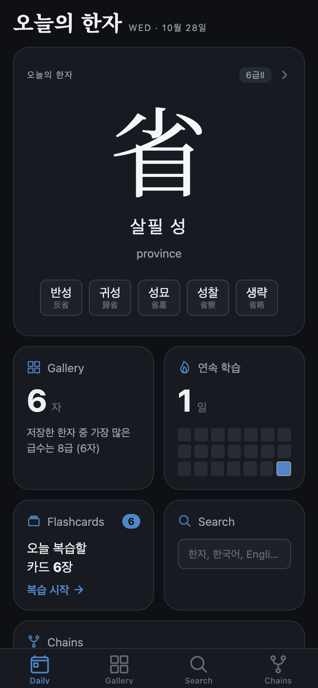
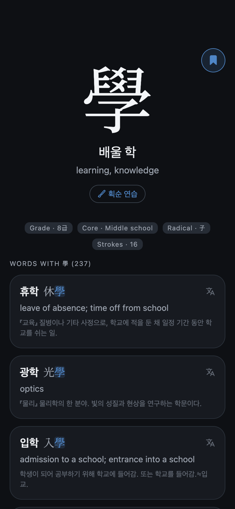
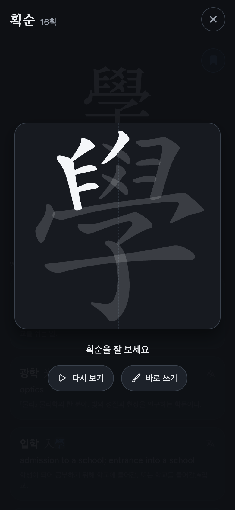
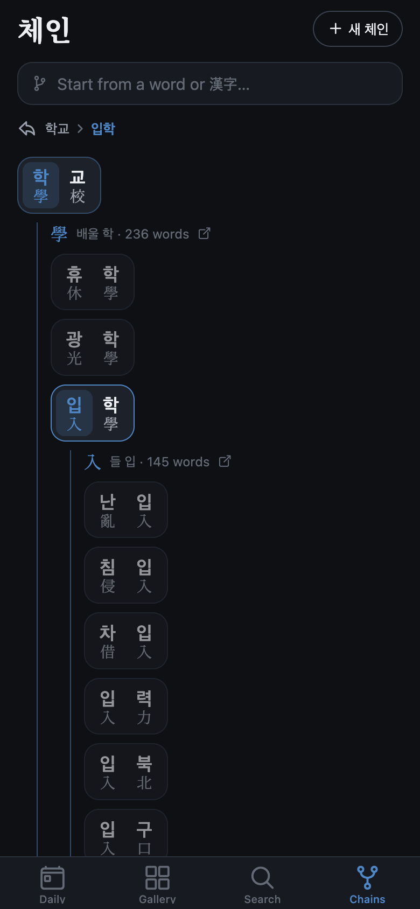
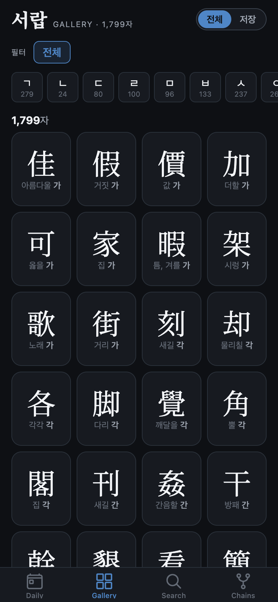

# 한자 체인 · Hanja Chain

A mobile app for learning **Hanja** (漢字, the Chinese characters used in Korean) the way
they actually show up: inside everyday Korean words. Every word is a chain of
characters, and every character links to more words. 학교 (學校, school) leads to 學,
which leads to 입학 (入學, admission), which leads to 入…

Built with Expo / React Native. Runs on iOS, Android and the web, fully offline.

<p align="center">
  
  
  
  
  
</p>

## Features

- **Daily:** a character of the day, your streak, flashcards due, and a jump into Chains.
- **Chains:** start from any word, tap a syllable to see other words sharing its Hanja,
  and keep branching. A breadcrumb shows the path you took.
- **Character detail:** meaning, readings, grade, radical, stroke count, and the words
  that use it, ranked so common learner vocabulary comes first.
- **Stroke-order practice:** the character spins into a card and its strokes fill in one
  by one. Then you trace them with your finger, and each correct stroke fills in. Strokes
  are checked for shape, direction and order.
- **Gallery:** browse all 1,799 basic-education Hanja by initial consonant → vowel → syllable,
  or just the ones you've saved.
- **Search:** by Hanja, Korean, or English.
- **Flashcards:** saved characters are scheduled with the SM-2 spaced-repetition algorithm.

## How it works

```
hanja-chain-data (separate pipeline)          this repo
────────────────────────────────────          ──────────────────────────────────────────
scrape stdict + krdict, merge grade    ──►    scripts/build-local-db.py
lists, Unihan → hanja.sqlite (117 MB)         trims to assets/db/hanja.db (16 MB) + stroke data
                                                         │
                                                         ▼
                                              expo-sqlite (on device, read-only)
                                                         │
                                              src/data: DataSource interface
                                                         │
                                              screens (expo-router)   +   user.db (saved, streak, SRS)
```

- **Offline-first.** A trimmed dictionary ships inside the app: every character, every
  learner-dictionary word, topped up to at least 12 words per character. Screens only talk to an async
  `DataSource` interface, so a future API for the long tail can slot in without screen
  changes.
- **User state** (saved characters, history, streak, flashcard schedule) lives in a separate
  writable SQLite database. Screens re-query live when it changes.
- **Stroke matching** resamples your finger stroke and the reference median to the same
  number of points. It then compares shape, start and end points, and direction, and picks
  the closest remaining stroke so parallel strokes (三) can't be drawn out of order. See
  [`src/components/strokes/geometry.ts`](src/components/strokes/geometry.ts).
- **Typography:** a subset of Noto Serif CJK KR (only the glyphs the app can show) keeps the
  Hanja crisp on every platform.

**Stack:** Expo SDK 58 · React Native 0.88 · React 19 · TypeScript · expo-router ·
expo-sqlite · react-native-reanimated · react-native-svg

## Running it

```bash
npm install
npx expo start        # press w for web, or scan the QR code with Expo Go / a dev build
```

The dictionary database is committed, so the app runs as-is. To rebuild it you need the
data pipeline's `hanja.sqlite` next to this repo (`../hanja-chain-data/`):

```bash
python3 scripts/build-local-db.py      # → assets/db/hanja.db (+ downloads stroke data once)
python3 scripts/build-font-subset.py   # after the character set changes
```

More detail on architecture, decisions and known gaps is in [`HANDOFF.md`](HANDOFF.md).

## Credits & licenses

Code: [MIT](LICENSE). The bundled dictionary data, stroke-order data and fonts come from
the National Institute of Korean Language, 한국어문회, Unicode, animCJK, Make Me a Hanzi
and Adobe/Google Noto, each under its own terms. See [`DATA-NOTICE.md`](DATA-NOTICE.md).
